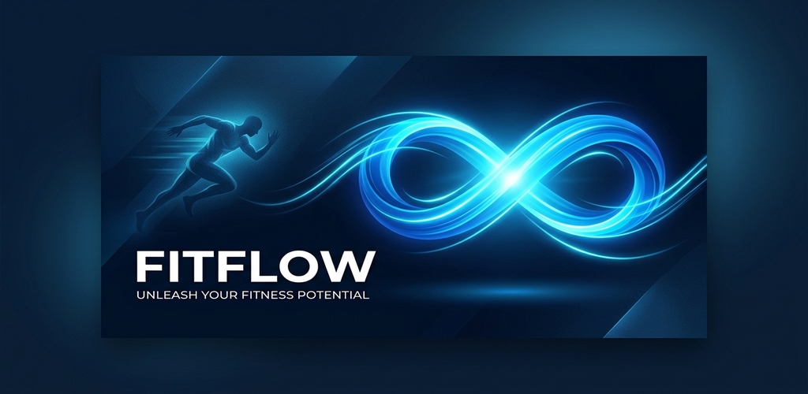
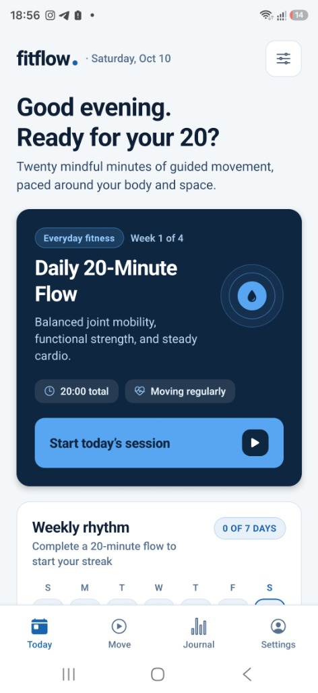
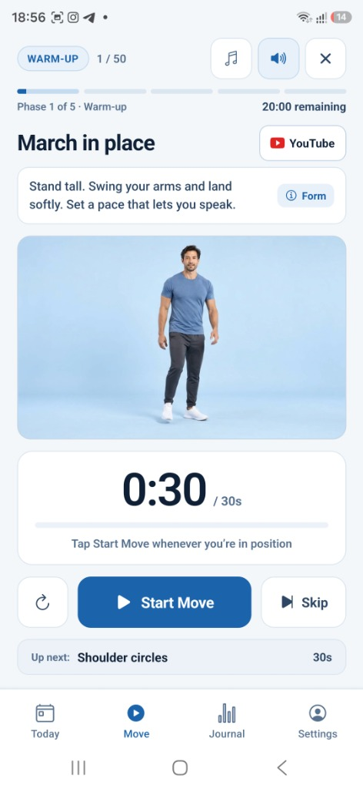
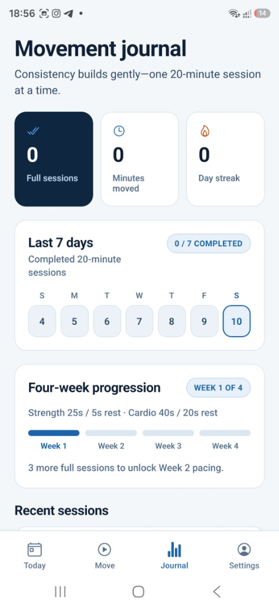
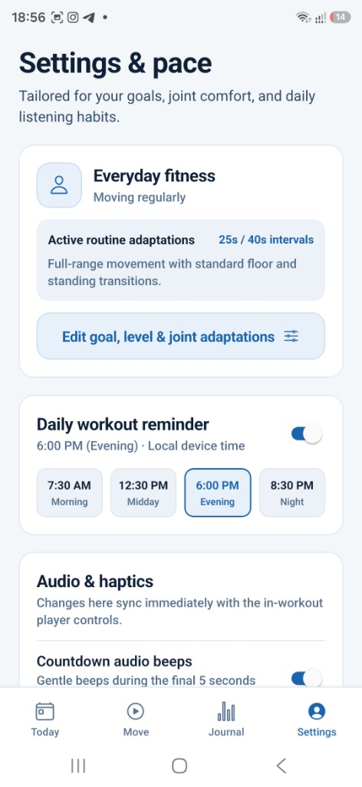

# FitFlow

<p align="center">
  
</p>

<p align="center">
  <a href="https://www.youtube.com/@FitFlowWorld?sub_confirmation=1">
    
  </a>
  
  
</p>

<p align="center">
  <strong>Mindful, adaptive 20-minute daily movement designed for lifelong joint health, stamina, and consistency.</strong><br>
  <em>100% offline-first · Zero ads · Zero tracking · Powered by community support</em>
</p>

---

## 📺 Support the Channel — Drop a Follow, Like & Comment!

> **FitFlow is 100% free, private, and open.**  
> There are **no subscriptions**, **no paywalls**, **no sign-ups**, and **zero advertisements**.

The single biggest way you can support this project and keep it free is by supporting our official YouTube channel:

### 🔴 [👉 Subscribe to @FitFlowWorld on YouTube](https://www.youtube.com/@FitFlowWorld?sub_confirmation=1)

* **🔔 Drop a Subscribe & Follow:** Help grow the community and unlock more guided movement content.
* **👍 Like the Tutorial Videos:** Every exercise in the app links directly to full form demonstrations on YouTube—drop a like whenever a video helps your movement!
* **💬 Leave a Comment:** Tell us how today's 20 felt, ask form questions, and suggest routines you want added to the app!

---

## App Screenshots

| 1. Today's Routine | 2. Movement HUD | 3. Movement Journal | 4. Settings & Adaptations |
| :---: | :---: | :---: | :---: |
|  |  |  |  |

---

## Overview

FitFlow is a React Native mobile application built on **Expo SDK 57** that guides users through a balanced, daily 20-minute home movement routine. Every session adheres strictly to an exact **1,200-second (20:00) duration invariant**, divided into five scientifically sequenced phases:

1. **Warm-Up & Mobility (3:00)** — Joint prep, dynamic reaches, and spinal lubrication.
2. **Foundation Strength (6:00)** — Controlled bodyweight resistance with tailored work/rest ratios.
3. **Aerobic Capacity (4:30)** — Steady, joint-friendly cardio intervals.
4. **Core Stability (3:30)** — Low-back support and anti-rotational stability.
5. **Cooldown & Breathing (3:00)** — Parasympathetic nervous system reset and stretching.

---

## Key Features

* **Adaptive Joint & Movement Customization:**
  * **Low Impact:** Zero jumping, gentle marching, and soft landings.
  * **Standing Only:** Swaps all floor exercises (planks, bridges, dead bugs) for standing variations for small spaces or limited floor mobility.
  * **Knee-Friendly:** Substitutes deep lunges with lateral weight shifts and balance taps.
  * **Age-Adaptive Progression:** Users aged 55+ automatically receive extra recovery breathing intervals between work sets; users 65+ default to joint-friendly standing variations.
* **Smart Video & Audio HUD:**
  * High-definition video demonstrations with upcoming exercise previews during rest intervals.
  * 5-second countdown audio beeps and tactile haptic pulses so users never need to stare at the screen.
  * Ambient instrumental background music that automatically ducks when countdown beeps trigger.
  * Large, accessible HUD buttons (44pt+ touch targets) for effortless pause, skip, and volume control mid-movement.
* **Direct YouTube Video Form Guides:**
  * Every movement links directly to high-definition video tutorials and form breakdowns on [@FitFlowWorld](https://www.youtube.com/@FitFlowWorld).
  * Post-workout community prompt invites users to subscribe, comment, and suggest new workout flows.
* **Habit & Progress Tracking:**
  * Local streak tracker calculated against distinct local calendar dates.
  * Post-workout Rate of Perceived Exertion (RPE) feedback that dynamically adapts future recovery intervals.
  * 4-week progression stats showing total active minutes, completion rate, and interval work-to-rest ratios.
* **Configurable Local Reminders:**
  * Daily workout notifications scheduled with customizable time presets (7:30 AM, 12:30 PM, 6:00 PM, 8:30 PM) via local device alarms.
* **100% Offline & Private:**
  * Zero user accounts, zero cloud servers, zero advertisements, and zero third-party telemetry.
  * Full JSON journal backup/export and one-tap local data erasure.

---

## Tech Stack

* **Framework:** [React Native 0.86](https://reactnative.dev/) with [Expo SDK 57](https://docs.expo.dev/versions/v57.0.0/)
* **Language:** TypeScript 6
* **Navigation:** React Navigation v7 (Bottom Tabs)
* **Media & Audio:** `expo-video`, `expo-audio`, `expo-haptics`, `expo-notifications`
* **Storage:** `@react-native-async-storage/async-storage` (device-sandboxed)
* **Design System:** Custom semantic design tokens (`src/components/ui.tsx`) with high contrast, tabular numerals, and fluid responsive layouts.

---

## Getting Started

### Prerequisites
* Node.js 18+
* npm 9+
* [Expo Go](https://expo.dev/go) app on Android or iOS

### Running Locally
```bash
# Clone the repository
git clone https://github.com/dongido001/FitFlow.git
cd FitFlow

# Install dependencies
npm install

# Start the Expo development server
npx expo start
```

Scan the QR code in the terminal with **Expo Go** on Android or the Camera app on iOS to run the app immediately.

---

## Quality & Testing

Run the automated test suite and typechecks:

```bash
# TypeScript compilation check
npm run typecheck

# 20-minute invariant and core unit test suite
npm test

# Verify Expo project configuration and dependencies
npx expo-doctor
```

---

## Security & Privacy Guarantee

* **Sandboxed Storage:** All user data is restricted strictly to the operating system's private application sandbox.
* **Zero Telemetry:** No analytics SDKs, trackers, or external network requests are made during workouts.
* Review the full [`PRIVACY_POLICY.md`](./PRIVACY_POLICY.md) for details.

---

## Community & Contributing

Have feedback or ideas for new movement routines?
* Subscribe and comment on [YouTube (@FitFlowWorld)](https://www.youtube.com/@FitFlowWorld).
* Open an issue or discussion on this repository.

---

## License

This project is licensed under the MIT License - see the [LICENSE](./LICENSE) file for details.
